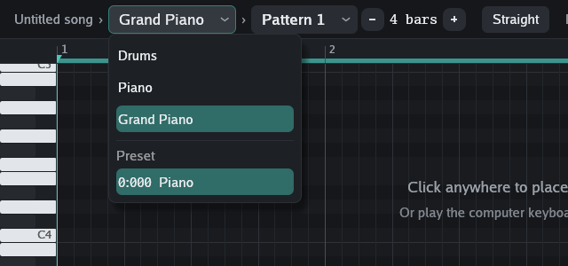
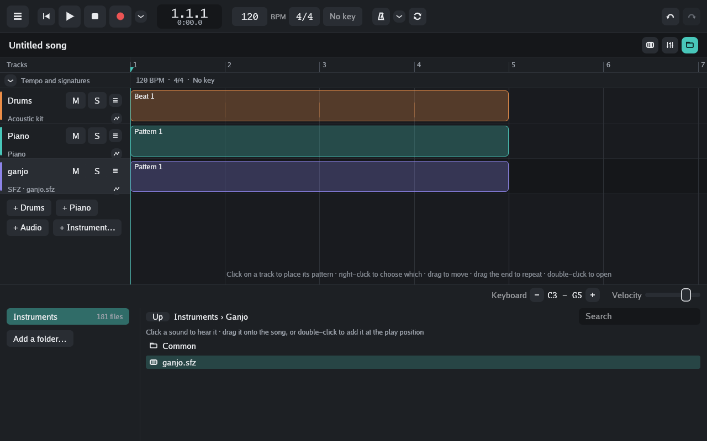
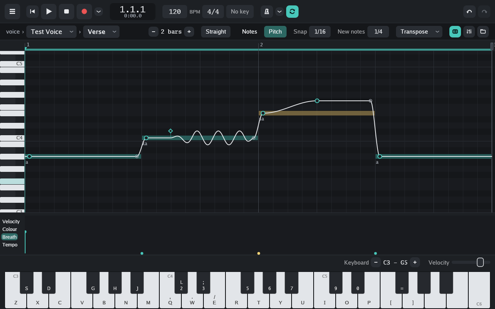
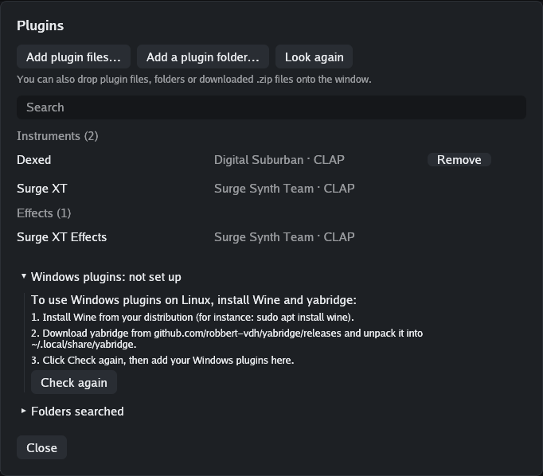
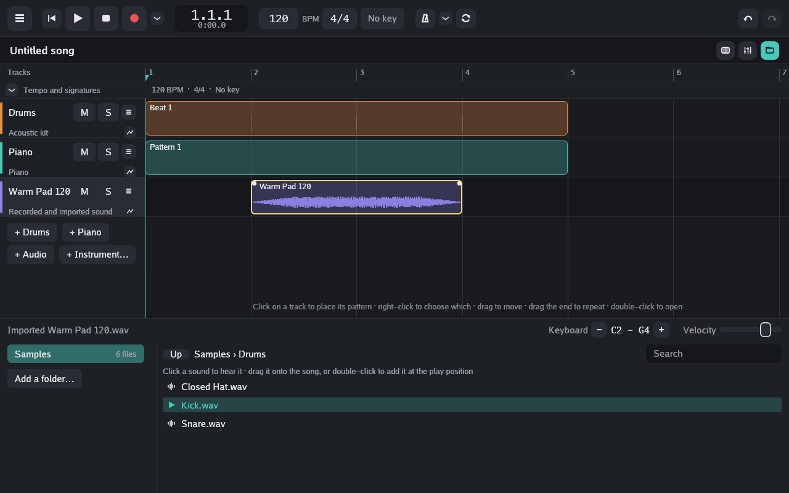
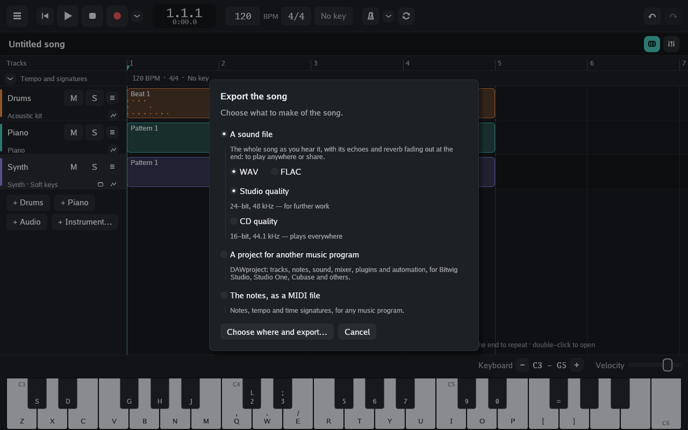

# VLabs user guide

VLabs is a music workstation for Windows and Linux: build a beat on a step
grid, write melodies and chords in a piano roll, record your voice or an
instrument, arrange it all on one timeline, mix it, and export it. It works
on a plain computer: built-in speakers or headphones, a mouse or trackpad and
a keyboard. A MIDI keyboard or an audio interface is used automatically when
you plug one in, but you never need one.

> Everything you do can be undone with <kbd>Ctrl+Z</kbd> (and redone with
> <kbd>Ctrl+Shift+Z</kbd>), and your work is saved automatically in the
> background, so try things freely.

## Installing

Download VLabs from its
[Releases page](https://github.com/ofujiiro/VLabs/releases/latest): the
installer for Windows, the AppImage for Linux.

**Windows.** Run the installer (`VLabs-…-setup.exe`). It installs for you
alone, needs no administrator rights, adds VLabs to the Start menu, and makes
VLabs songs open with a double-click. Windows may warn that the installer is
from an unknown publisher (it is not signed yet): choose **More info**, then
**Run anyway**. To remove VLabs, use Settings › Apps; your songs and settings
are kept.

**Linux.** Download the AppImage (`VLabs-…-x86_64.AppImage`), make it
executable (in your file manager's properties, or `chmod +x` in a terminal)
and double-click it. It runs on most distributions from 2024 on (it needs
glibc 2.39 or newer and the ALSA sound library, which every desktop has).
Tools such as AppImageLauncher can add it to your applications menu.

## The first minute

When VLabs starts, a new song shows the **whole song**: a **Drums** track
and a **Piano** track, each with an empty pattern placed on the first four
bars.

1. Double-click the **Beat 1** clip on the Drums track (or press
   <kbd>F5</kbd>): its **step grid** opens.
2. Click a few squares in the **Kick** and **Snare** rows.
3. Press <kbd>Space</kbd>: the beat plays. Press <kbd>Space</kbd> again to
   stop.
4. Play the computer keyboard: the key caps on the left of the grid show
   which key plays which drum.

That is a song. The rest of this guide shows how to grow it.

## The window

- **The top bar**: Play, Stop, Record, the loop and the metronome; the
  tempo, time signature and key in effect where the song is playing.
- **The location line**, under it: where you are (the song, a track, a
  pattern) and the tools for what is open. Click the song's name at its left
  (or press <kbd>F5</kbd>) to see the whole song.
- **The big area in the middle** shows one thing at a time: the song, the
  step grid of a drum pattern, or the piano roll of a melody.
- **The bottom area** shows the on-screen keyboard, or the mixer
  (<kbd>F9</kbd>).

## Patterns, tracks and the song

A **pattern** is a short piece of music: a beat, a bass line, a chord
progression. A **track** plays patterns with one instrument. The **song**
places patterns along time.

- In the song view, **click an empty spot** on a track to place the pattern
  you edited last there. **Right-click an empty spot** to choose which of the
  track's patterns to place, or to make a new one.
- **Right-click a clip** to open its pattern, split it, duplicate it, remove
  it, or make it play another of the track's patterns instead.
- Drag a clip to move it; drag its right end to make it repeat longer.
- In a pattern, the menu of the location line makes new patterns, copies
  (duplicates) and renames them.

### Selecting and moving several at once

- **Tracks:** click a track's name to select it, <kbd>Ctrl</kbd>+click
  others to add (or remove) them, <kbd>Shift</kbd>+click to select every
  track between. Then **drag a selected track's name up or down**: the
  selected tracks move there together, in their order. The mixer follows
  the new order.
- **Clips:** <kbd>Ctrl</kbd>+click clips to add them to the selection
  (again to take one out), or hold <kbd>Ctrl</kbd> (or <kbd>Shift</kbd>)
  and drag from an empty spot to draw a box around them;
  <kbd>Ctrl+A</kbd> selects them all. **Drag one of them** by its middle:
  they all move together. <kbd>Delete</kbd> removes them,
  <kbd>Ctrl+D</kbd> places a copy of them right after, and the keys that
  move a clip by a bar move them all. <kbd>Escape</kbd> clears the
  selection.

## The step grid (drums)

Click or drag along a row to add hits; click a hit to remove it. The strip
under the grid sets how hard each step plays. Click a sound's name to hear it
and to change its volume, pan, tuning and length. **Kit** chooses between the
acoustic and the electronic kit. Drag the small tab at the right end of the
ruler to make the pattern longer or shorter (any number of steps).

### Custom kits: a drum kit of your own sounds

A custom kit is a drum track whose pads are your own sounds: kicks, claps,
vocal chops, a door slamming. Each sound gets its own key and its own row in
the step grid.

- **+ Instrument…**, **Custom kit**: choose sounds (WAV, AIFF, FLAC, MP3 or
  Ogg; pick many at once). Each becomes a pad named after its file, and the
  step grid opens with one row per pad.
- **More sounds:** **Add sounds…** on the line above the grid, drop files on
  the grid, or drag sounds from the library onto it.
- **A whole folder at once:** in the library, right-click a folder and
  choose **Make a kit of these sounds**.
- Click a pad's name to hear it and change its volume, pan, tuning and
  length, rename it, or **Remove from the kit**.
- The computer keyboard plays the pads as it plays a drum kit (Z is the
  first pad). A kit holds up to 128 sounds.
- The sounds are copied into the song, so the song opens anywhere with its
  kit.

## The piano roll (melodies and chords)

- Click to place a note (you hear it); drag from an empty spot to draw a
  longer note. Drag a note to move it, drag its right edge to change its
  length, right-click it to delete it.
- The lane at the bottom sets each note's velocity (how hard it plays).
- **Snap** chooses the grid notes land on, including triplets, quintuplets
  and septuplets. **New notes** chooses their length.
- <kbd>Ctrl+A</kbd> selects all; <kbd>Ctrl+C</kbd>, <kbd>Ctrl+X</kbd> and
  <kbd>Ctrl+V</kbd> copy, cut and paste; the arrow keys move the selection
  (<kbd>Shift</kbd> with up and down moves by octaves).

## Keys, scales and chords

Click the key button in the top bar ("No key" at first) and choose a key,
for example A minor. The piano roll then shades the notes outside the key
and marks the key's tonic.

- **Snap › Keep notes in the key** puts new and moved notes on notes of the
  key.
- **Draw** chooses what a click places: a single note, a chord built in the
  key (in C major, a click on D places D minor), or a chord of a chosen kind,
  in any inversion. The chord and its name show under the pointer before you
  click.
- **Transpose** moves the selection by any interval, or by steps of the key;
  <kbd>Alt+Up</kbd> and <kbd>Alt+Down</kbd> invert chords.

## Tempo, time signatures and swing

In the song view, open **Tempo and signatures** under the ruler. Click a bar
in the signatures strip to change the time signature or key from there
(everything after keeps its bars). Click the tempo line to add a tempo
change and drag its point to change it.

For a gradual change (a *ritardando* or an *accelerando*), click a point:
**Arrive gradually** slows down or speeds up from the previous change to
this one, and **Glide to the next tempo** from this one to the next. The
line then slopes, marked *rit.* or *accel.*, with a small diamond in its
middle. Click the diamond to choose how the tempo moves:

- **Even**: by the same amount on every beat;
- **Late**: it holds back, then changes more and more, the way a pianist
  slows into a final chord;
- **Early**: most of the change comes first, then it settles.

Drag the diamond up or down for any shape in between, or right-click it to
make the change sudden again.

When you write in the piano roll, click **Tempo** at the left of the lane
under the notes: it shows the song's tempo where the pattern plays, and you
can shape it there, under the phrase. **Velocity** brings the notes'
loudness back.

In a pattern, **Swing** delays every second eighth or sixteenth note:
"Triplet feel" is the classic shuffle.

## Instruments

**+ Instrument…** under the tracks offers the instruments that come with
VLabs, then every plugin found on your computer:

- **Piano**: a sampled grand piano.
- **Drums**: the drum sampler with two kits.
- **Custom kit**: a drum kit of your own sounds (see
  [Custom kits](#custom-kits-a-drum-kit-of-your-own-sounds)).
- **Synth**: VLabs's own synthesizer (below).
- **SoundFont or SFZ…**: a track playing an instrument file of yours. Many
  free and paid sampled instruments (pianos, drum kits, orchestras) come
  as a **SoundFont** (`.sf2`) or as an **SFZ instrument** (an `.sfz` file
  next to a folder of sounds).
  - A SoundFont's sounds ("presets") are chosen in the track's menu, at the
    top left of its pattern.
  - An SFZ instrument is read in the background, however large: its track
    is silent for a moment while the status line says "Reading the
    instrument…", then plays. If the instrument uses something VLabs does
    not play yet (such as vibrato made by an LFO), the status line says so
    once, and the rest plays.
  - The song remembers where the file is; on a computer without it, the
    track plays a plain sound and VLabs says which file is missing.

### Note shape: how notes start and end

The piano, SoundFonts, SFZ instruments, drum kits and custom kits have a
**Note shape** button (a small rise-and-fall line) in their track's header
and next to the track's name above its pattern. It opens a panel:

- **Attack**: how long a note takes to rise to full level. Tick it to set
  it; unticked, the instrument plays its notes as they were recorded.
- **Release**: how long a note takes to fall silent once its key comes up.
- **Cut at note end** makes every note stop the moment its key comes up,
  with no ringing tail: the "release cut" sound, on the piano or anything
  else. **Soft start** makes notes swell in, **Long tail** lets them ring
  on, **Natural** goes back to the instrument's own way.
- On a kit, a release also makes each hit stop at the end of its note,
  however long its sound: lengthen or shorten the notes to cut a sound
  where you want.
- With a release set, a SoundFont's own reverb is left out, so a cut
  sounds cut; add a **Reverb** effect to the track if you want a room.

The synth has full envelopes of its own (in its window), and plugins have
theirs.

## The synth

Add a synth track, then click the window button on its track header (or in
the location line or the mixer) to open the synth. Start with a **preset**
(Soft keys, Warm pad, Bass, Sub bass, Lead, Pluck, Brass, Plain), then shape
it while you play the computer keyboard:

- **Oscillators**: two waves (sine, triangle, saw, square), each with an
  octave, semitones, a fine tune and a level; noise; the width of the square
  waves. Two oscillators slightly detuned sound wider.
- **Filter**: lower the **Cutoff** for a darker sound; **Resonance** makes it
  ring; **Envelope** opens the filter as each note plays; **Follow keys**
  opens it more for higher notes. The curve shows what the filter does.
- **Envelopes**: how the volume and the filter rise and fall (attack, decay,
  sustain, release). The pictures show their shapes.
- **Movement**: an LFO that wavers the pitch (vibrato), the filter (wobble)
  or the volume (tremolo).
- **Playing**: one note at a time with glide, for basses and leads; how much
  velocity matters; the volume.

Any of the synth's knobs can change over the song with an automation lane
(below): a filter that opens over eight bars is the classic one.

## Singing

A voice track sings its notes' lyrics with a voicebank you add: a classic
UTAU voicebank (a folder of recordings with an `oto.ini`, often shared as a
`.zip`).

1. Open the menu and choose **Voicebanks…**, then **Add a folder…** or
   **Add a .zip…**. The voicebank is copied into the program's own folder;
   its creator's terms are shown: read them, as they say what you may do
   with the voice. **Remove this voicebank** takes it out again.
2. **+ Instrument…** now lists your voicebanks under **Voices**: choose one
   to add a voice track.
3. Write a melody in its piano roll. Each note shows its lyric (a new note
   sings "a"). Select a note and press <kbd>Enter</kbd> (or double-click
   it) to type its lyric; words after a space go to the next notes, so
   "ka sa ne" fills three notes at once. <kbd>Enter</kbd> keeps what you
   typed, <kbd>Tab</kbd> keeps it and moves to the next note,
   <kbd>Escape</kbd> leaves the lyric as it was. A lyric the voicebank has
   no recording for is marked with a **?** and sung as "a". The lyric `R`
   is a rest.
4. Play: the voice is rendered in the background (the status line says
   "Rendering the voice…" meanwhile; a part not ready yet is silent), then
   sings with the song, through the mixer and its effects, and into exports.

Japanese lyrics can be typed in romaji (`ka`, `shi`, `kyo`) or in kana.
Kana show in the piano roll when your computer has a Japanese font
(Windows has one; on Linux, install the Noto CJK fonts); otherwise they are
shown in romaji. VCV voicebanks get the syllable sung after the previous
note's vowel ("a か") automatically, CV voicebanks the syllable alone.

Copying, pasting and duplicating notes keeps their lyrics (and how they
are sung, below). MIDI files you export carry the lyrics, and MIDI files
with lyrics bring them in on their notes.

A voicebank's picture, the face its creator gave it, shows faintly
wherever the voice sings: in its track's header, at the start of each of
its clips, and large behind the notes of its piano roll, without covering
them. **+ Instrument…** shows it beside the voicebank's name. A voicebank
without a picture shows none.

### Shaping the voice

A voice track's piano roll draws the pitch the voice sings as a white line
through the notes: you see each glide from one note into the next. Where
**Draw** is on other tracks, the location line has **Notes** and
**Pitch**; <kbd>Ctrl+P</kbd> switches between them.

In **Pitch** the notes stay where they are (they step back) and the line
comes forward with its handles:

- **Bend the voice:** click over a note and the voice goes through that
  spot (keep the button down to move it there and then). A click a little
  below a note, just after it starts, makes the voice scoop up into it; a
  click a little above it, just after the glide arrives, makes it
  overshoot and settle.
- **Points** are dragged in time and pitch. The small hollow point where a
  glide leaves the note before always leaves from wherever the voice is, so
  it moves in time only: drag it earlier for a slower, earlier glide.
  Click a point for its exact time and pitch and the shape of the curve
  after it (**Smooth**, **Straight**, **Slow start**, **Slow end**);
  right-click it to remove it. **Transpose › Plain pitch** puts the selected
  notes back to the plain glide.
- **Vibrato:** select notes and choose **Transpose › Add vibrato**. Long
  notes start to swing a quarter of a second in and grow into it; short
  notes stay plain. Each vibrato has a small diamond where it starts, as
  high above the note as the vibrato is deep: drag it sideways to start
  earlier or later, up or down for a wider or narrower swing. Click it for
  its depth, rate (swings a second), start and how long it takes to grow;
  right-click it to remove it.

The lane under a voice's notes shows four things, edited like velocity (drag
a note's bar; the selected notes move together):

- **Velocity**: how loud each note is sung.
- **Colour**: lighter and brighter above the middle line, darker and deeper
  below it, without changing the pitch.
- **Breath**: how breathy each note is.
- **Tempo**: the song's tempo, as on every track.

For a crescendo across a phrase, use the track's volume automation (see
Automation).

## Recording

**Notes**: press <kbd>Ctrl+R</kbd> (or the red button) with a piano or synth
track in focus. A bar of clicks counts you in; play on the computer keyboard
or a MIDI keyboard; press <kbd>Space</kbd> to stop. One undo removes the
whole take.

**Sound**: add an audio track (**+ Audio**), then record the same way from
the computer's microphone or an audio interface. Use headphones: VLabs does
not play the microphone back to you, and speakers would be recorded too.

## Audio clips

Bring in sound files with **Import…** (<kbd>Ctrl+I</kbd>) or by dropping them
on the song: WAV, FLAC, MP3 and Ogg Vorbis. On the timeline, drag a clip's
ends to trim it, the small squares at its top corners to fade it, and
right-click it to split it or change its volume.

### The sound editor

**Double-click** an audio clip (or choose **Edit sound…** in its
right-click menu) to open it in a window of its own. It shows the clip's
whole sound, with the part the clip plays lit:

- drag the **ends** to cut the clip exactly where you want (they do not
  snap to beats here); the sound stays where it is in the song;
- drag the **small squares** at the top to fade it in and out;
- **Volume**, and **As loud as it can be**, which sets the volume so the
  loudest moment is just under full scale;
- **Pitch**, in semitones: like a tape, the sound also plays faster
  (higher) or slower (lower), so the clip gets shorter or longer;
- **Backwards** plays the clip's sound in reverse.

Every change can be undone, one at a time, and shows on the timeline at
once.

## The mixer and effects

Press <kbd>F9</kbd>. Each track has a fader, pan, mute and solo, a level
meter and an effect chain: **+ Add effect** offers the EQ, compressor,
reverb, delay and limiter, then your plugin effects. Click an effect to
adjust it.

## Automation

In the song view, the zigzag button on a track's header adds a lane for one
of its settings: volume, pan, an effect's setting, a synth knob or a plugin
parameter. Click the lane to add points, drag them, right-click to remove
them; the line is what the setting does as the song plays.

## Plugins

VLabs uses CLAP and VST3 instruments and effects. **Plugins…** in the menu
(or in **+ Instrument…**) opens the Plugins window: every plugin found,
with who made it, and the files that could not be used, with why.

- **To add a plugin you downloaded**, drop it on the window: a `.vst3` or
  `.clap` file, the folder it came in, or the `.zip` file itself. Or use
  **Add plugin files…** and **Add a plugin folder…** (a `.vst3` plugin is
  really a folder). VLabs copies it into its own plugin folder, which it
  always searches, and tells you what it added. You never need to know
  where plugins go.
- **Installers** (`.exe`, `.msi`): on Windows, VLabs opens the installer;
  finish it, then click **Look again**. On Linux, it runs it through Wine
  when Wine is installed.
- **Remove** takes out a plugin added this way. Plugins installed by their
  own installers are left alone: uninstall them as usual.
- **Folders searched** lists where VLabs looks, and **Search another
  folder…** adds one of yours (plugins there stay where they are).

VLabs also looks in the usual folders by itself:

| System | Folders |
| --- | --- |
| Windows | `Common Files\CLAP` and `Common Files\VST3` in Program Files, and the same under `%LOCALAPPDATA%\Programs\Common` |
| Linux | `~/.clap`, `~/.vst3`, `/usr/lib/clap`, `/usr/lib/vst3`, `/usr/local/lib/clap`, `/usr/local/lib/vst3` |

**Windows plugins on Linux** work through Wine and
[yabridge](https://github.com/robbert-vdh/yabridge). Install both once (the
Plugins window shows the steps, then click **Check again**); after that,
a Windows plugin you add is set up for VLabs automatically and appears with
the others.

**VST2 plugins** (`.dll` files) are not supported yet: VLabs tells you so
when you add one. Most plugins also come as VST3 or CLAP; look for that
version on the maker's site.

**A plugin that stays silent** often waits for something in its own window:
open it with the window button on its track.

- **MT Power Drum Kit 2** (free version) mutes itself each time it starts:
  click **START** at the bottom right of its window, every session.
- **Decent Sampler** plays nothing until you load a sample library into it
  (**FILE…**, **Load…**, or **BROWSE** for its store).
- On Linux, a plugin may need system libraries of its own. VLabs names the
  missing one in the Plugins window: install that package, then click
  **Look again**.

## The sound library

The folder button at the top right (or <kbd>F6</kbd>) shows the library in
place of the keyboard. **Add a folder…** (or drop a folder on the window)
adds a folder of sounds: WAV, AIFF, FLAC, MP3 and Ogg files, MIDI files,
SoundFonts and SFZ instruments, however many there are. Nothing is copied
or moved.

- Click a folder to open it; **Up** goes back.
- **Click a sound to hear it**; click it again to stop.
- **Drag** a sound onto the song to put it there, on the beat where you let
  go; **double-click** puts it at the play position. MIDI files become
  tracks of notes, SoundFonts and SFZ instruments become instrument tracks.
- The **Search** field looks through every folder at once, for every word
  you type ("kick hard").
- Right-click a folder on the left to look through it again (after adding
  files) or to remove it from the library (the files stay on your disk).
- Right-click a folder, **Make a kit of these sounds**: a custom kit of
  every sound in it (see [Custom kits](#custom-kits-a-drum-kit-of-your-own-sounds)).

## Saving, opening and recovering

<kbd>Ctrl+S</kbd> saves the song as a VLabs song file, with its sound and
its plugins' settings inside. **Open…** (<kbd>Ctrl+O</kbd>) opens VLabs
songs, and also DAWproject and MIDI files from other programs: they open as
a new song, which you then save as a VLabs song (the original file is never
changed).

While a song has unsaved changes, VLabs keeps a copy of it every few
seconds, and right before a plugin loads or opens its window. If the program
stops unexpectedly, it offers your work back the next time it starts,
including a recording that was in progress.

## Importing and exporting

- **Import…** (<kbd>Ctrl+I</kbd>) adds sound files (WAV, AIFF, FLAC, MP3,
  Ogg) and MIDI files to the song at the play position (a MIDI file's
  tracks become tracks of notes). Dropping files on the window does the
  same; dropping a song file opens it, a SoundFont or an SFZ instrument
  becomes an instrument track, plugins go to the Plugins window and
  folders to the library.
- **Export…** (<kbd>Ctrl+E</kbd>) makes, from the song:
  - **a sound file**: WAV or FLAC (FLAC is about half the size, with nothing
    lost), in studio quality (24-bit, 48 kHz) or CD quality (16-bit,
    44.1 kHz). The song plays once from its start (a loop you set for
    playing is left out) to the end of its last clip, and on only while
    notes and effects still ring: the file ends where the sound does;
  - **a project for another music program**: a DAWproject file, which
    Bitwig Studio, Studio One, Cubase and others open with the tracks,
    notes, sound, mixer, plugins and automation;
  - **the notes as a MIDI file**, for any music program.

## Keyboard shortcuts

| Keys | Does |
| --- | --- |
| <kbd>Space</kbd> | Play or stop |
| <kbd>Ctrl+R</kbd> | Record |
| <kbd>Ctrl+Z</kbd> / <kbd>Ctrl+Shift+Z</kbd> | Undo / redo |
| <kbd>Ctrl+S</kbd> / <kbd>Ctrl+O</kbd> | Save / open |
| <kbd>Ctrl+I</kbd> / <kbd>Ctrl+E</kbd> | Import / export |
| <kbd>F5</kbd> | Switch between the song and the open pattern |
| <kbd>F9</kbd> | Show or hide the mixer |
| <kbd>F6</kbd> | Show or hide the sound library |
| <kbd>Page Up</kbd> / <kbd>Page Down</kbd> | The computer keyboard's octave |
| <kbd>Ctrl+B</kbd> | Split the selected clip at the play position |
| <kbd>Ctrl+P</kbd> | On a voice track: edit the notes or the sung pitch |
| <kbd>F1</kbd> | This guide |

Every shortcut can be changed in the menu's **Keyboard shortcuts**, and
none of them ever clashes with the keys that play notes.

## When something does not work

- **No sound.** Check the system's volume and output device; VLabs uses the
  system's default output and follows it when it changes. The top bar says
  when no sound device was found.
- **A MIDI keyboard does nothing.** Plug it in (VLabs notices it while
  running and says so) and put a piano, synth or plugin track in focus.
- **A plugin is missing.** Install it in one of the usual folders, then
  click **Look again** in the instrument chooser. A song whose plugin is not
  installed still opens; the missing plugin is named.
- **The program stopped.** Start it again: it offers your work back.
- **Recordings are out of time.** Use headphones and keep other programs
  that use the sound card closed.

VLabs is free software (GNU GPL version 3 or later). Its source and the
licences of everything it includes are in `LICENSE` and
`THIRD_PARTY_NOTICES.txt` next to the program.
