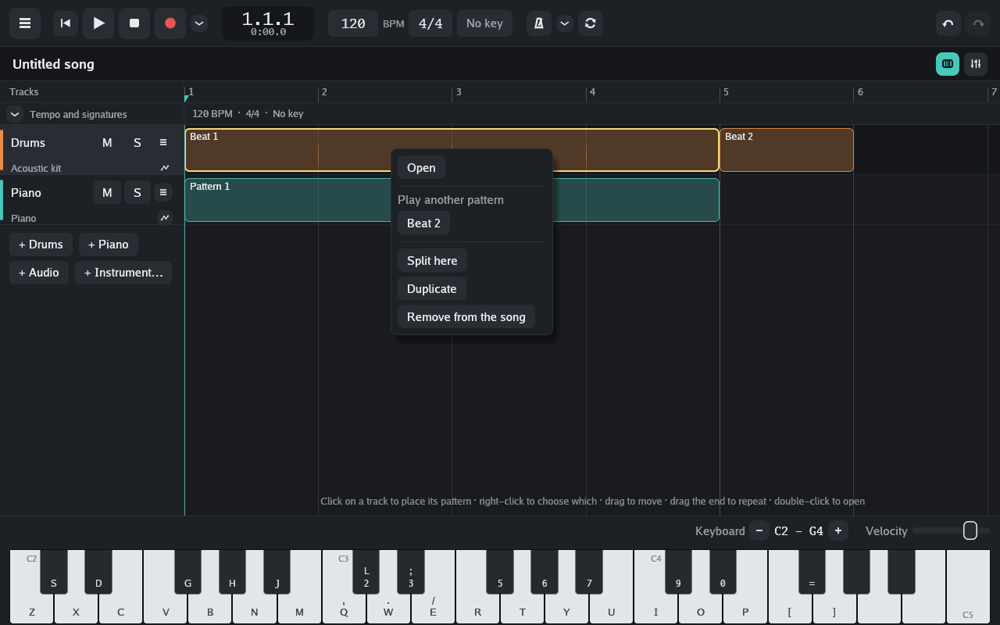
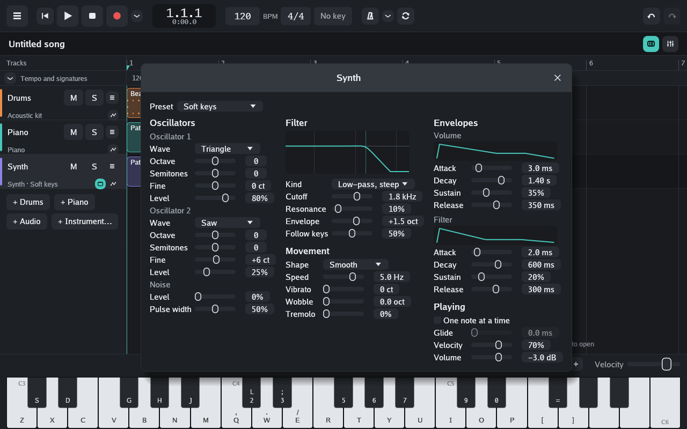

# VLabs user guide

VLabs is a music workstation for Windows and Linux: build a beat on a step
grid, write melodies and chords in a piano roll, record your voice or an
instrument, arrange it all on one timeline, mix it, and export it. It works
on a plain computer: built-in speakers or headphones, a mouse or trackpad and
a keyboard. A MIDI keyboard or an audio interface is used automatically when
you plug one in, but you never need one.

> Everything you do can be undone with <kbd>Ctrl+Z</kbd> (and redone with
> <kbd>Ctrl+Shift+Z</kbd>), and your work is saved automatically in the
> background, so try things freely.

## Installing

**Windows.** Run the installer (`VLabs-…-setup.exe`). It installs for you
alone, needs no administrator rights, adds VLabs to the Start menu, and makes
VLabs songs open with a double-click. Windows may warn that the installer is
from an unknown publisher (it is not signed yet): choose **More info**, then
**Run anyway**. To remove VLabs, use Settings › Apps; your songs and settings
are kept.

**Linux.** Download the AppImage (`VLabs-…-x86_64.AppImage`), make it
executable (in your file manager's properties, or `chmod +x` in a terminal)
and double-click it. It runs on most distributions from 2024 on (it needs
glibc 2.39 or newer and the ALSA sound library, which every desktop has).
Tools such as AppImageLauncher can add it to your applications menu.

## The first minute

When VLabs starts, a new song is open on the **step grid** of its drum track:

1. Click a few squares in the **Kick** and **Snare** rows.
2. Press <kbd>Space</kbd>: the beat plays. Press <kbd>Space</kbd> again to
   stop.
3. Play the computer keyboard: the key caps on the left of the grid show
   which key plays which drum.

That is a song. The rest of this guide shows how to grow it.

## The window

- **The top bar**: Play, Stop, Record, the loop and the metronome; the
  tempo, time signature and key in effect where the song is playing.
- **The location line**, under it: where you are (the song, a track, a
  pattern) and the tools for what is open. Click the song's name at its left
  (or press <kbd>F5</kbd>) to see the whole song.
- **The big area in the middle** shows one thing at a time: the song, the
  step grid of a drum pattern, or the piano roll of a melody.
- **The bottom area** shows the on-screen keyboard, or the mixer
  (<kbd>F9</kbd>).

## Patterns, tracks and the song

A **pattern** is a short piece of music: a beat, a bass line, a chord
progression. A **track** plays patterns with one instrument. The **song**
places patterns along time.

- In the song view, **click an empty spot** on a track to place the pattern
  you edited last there. **Right-click an empty spot** to choose which of the
  track's patterns to place, or to make a new one.
- **Right-click a clip** to open its pattern, split it, duplicate it, remove
  it, or make it play another of the track's patterns instead.
- Drag a clip to move it; drag its right end to make it repeat longer.
- In a pattern, the menu of the location line makes new patterns, copies
  (duplicates) and renames them.

## The step grid (drums)

Click or drag along a row to add hits; click a hit to remove it. The strip
under the grid sets how hard each step plays. Click a sound's name to hear it
and to change its volume, pan, tuning and length. **Kit** chooses between the
acoustic and the electronic kit. Drag the small tab at the right end of the
ruler to make the pattern longer or shorter (any number of steps).

## The piano roll (melodies and chords)

- Click to place a note (you hear it); drag from an empty spot to draw a
  longer note. Drag a note to move it, drag its right edge to change its
  length, right-click it to delete it.
- The lane at the bottom sets each note's velocity (how hard it plays).
- **Snap** chooses the grid notes land on, including triplets, quintuplets
  and septuplets. **New notes** chooses their length.
- <kbd>Ctrl+A</kbd> selects all; <kbd>Ctrl+C</kbd>, <kbd>Ctrl+X</kbd> and
  <kbd>Ctrl+V</kbd> copy, cut and paste; the arrow keys move the selection
  (<kbd>Shift</kbd> with up and down moves by octaves).

## Keys, scales and chords

Click the key button in the top bar ("No key" at first) and choose a key,
for example A minor. The piano roll then shades the notes outside the key
and marks the key's tonic.

- **Snap › Keep notes in the key** puts new and moved notes on notes of the
  key.
- **Draw** chooses what a click places: a single note, a chord built in the
  key (in C major, a click on D places D minor), or a chord of a chosen kind,
  in any inversion. The chord and its name show under the pointer before you
  click.
- **Transpose** moves the selection by any interval, or by steps of the key;
  <kbd>Alt+Up</kbd> and <kbd>Alt+Down</kbd> invert chords.

## Tempo, time signatures and swing

In the song view, open **Tempo and signatures** under the ruler. Click a bar
in the signatures strip to change the time signature or key from there
(everything after keeps its bars). Click the tempo line to add a tempo
change, drag its point to change it, and tick **Glide to the next tempo** for
a gradual speeding up or slowing down.

In a pattern, **Swing** delays every second eighth or sixteenth note:
"Triplet feel" is the classic shuffle.

## Instruments

**+ Instrument…** under the tracks offers the instruments that come with
VLabs, then every plugin found on your computer:

- **Piano**: a sampled grand piano.
- **Drums**: the drum sampler with two kits.
- **Synth**: VLabs's own synthesizer (below).

## The synth

Add a synth track, then click the window button on its track header (or in
the location line or the mixer) to open the synth. Start with a **preset**
(Soft keys, Warm pad, Bass, Sub bass, Lead, Pluck, Brass, Plain), then shape
it while you play the computer keyboard:

- **Oscillators**: two waves (sine, triangle, saw, square), each with an
  octave, semitones, a fine tune and a level; noise; the width of the square
  waves. Two oscillators slightly detuned sound wider.
- **Filter**: lower the **Cutoff** for a darker sound; **Resonance** makes it
  ring; **Envelope** opens the filter as each note plays; **Follow keys**
  opens it more for higher notes. The curve shows what the filter does.
- **Envelopes**: how the volume and the filter rise and fall (attack, decay,
  sustain, release). The pictures show their shapes.
- **Movement**: an LFO that wavers the pitch (vibrato), the filter (wobble)
  or the volume (tremolo).
- **Playing**: one note at a time with glide, for basses and leads; how much
  velocity matters; the volume.

Any of the synth's knobs can change over the song with an automation lane
(below): a filter that opens over eight bars is the classic one.

## Recording

**Notes**: press <kbd>Ctrl+R</kbd> (or the red button) with a piano or synth
track in focus. A bar of clicks counts you in; play on the computer keyboard
or a MIDI keyboard; press <kbd>Space</kbd> to stop. One undo removes the
whole take.

**Sound**: add an audio track (**+ Audio**), then record the same way from
the computer's microphone or an audio interface. Use headphones: VLabs does
not play the microphone back to you, and speakers would be recorded too.

## Audio clips

Bring in sound files with **Import…** (<kbd>Ctrl+I</kbd>) or by dropping them
on the song: WAV, FLAC, MP3 and Ogg Vorbis. On the timeline, drag a clip's
ends to trim it, the small squares at its top corners to fade it, and
right-click it to split it or change its volume.

## The mixer and effects

Press <kbd>F9</kbd>. Each track has a fader, pan, mute and solo, a level
meter and an effect chain: **+ Add effect** offers the EQ, compressor,
reverb, delay and limiter, then your plugin effects. Click an effect to
adjust it.

## Automation

In the song view, the zigzag button on a track's header adds a lane for one
of its settings: volume, pan, an effect's setting, a synth knob or a plugin
parameter. Click the lane to add points, drag them, right-click to remove
them; the line is what the setting does as the song plays.

## Plugins

VLabs uses CLAP and VST3 instruments and effects. It looks for them in the
usual folders when it starts:

| System | Folders |
| --- | --- |
| Windows | `Common Files\CLAP` and `Common Files\VST3` in Program Files, and the same under `%LOCALAPPDATA%\Programs\Common` |
| Linux | `~/.clap`, `~/.vst3`, `/usr/lib/clap`, `/usr/lib/vst3`, `/usr/local/lib/clap`, `/usr/local/lib/vst3` |

A plugin must be built for your system. On Linux, Windows plugins can work
through [yabridge](https://github.com/robbert-vdh/yabridge) and Wine: once
yabridge has set them up in those folders, VLabs sees them like any other.

## Saving, opening and recovering

<kbd>Ctrl+S</kbd> saves the song as a VLabs song file, with its sound and
its plugins' settings inside. **Open…** (<kbd>Ctrl+O</kbd>) opens VLabs
songs, and also DAWproject and MIDI files from other programs: they open as
a new song, which you then save as a VLabs song (the original file is never
changed).

While a song has unsaved changes, VLabs keeps a copy of it every few
seconds, and right before a plugin loads or opens its window. If the program
stops unexpectedly, it offers your work back the next time it starts,
including a recording that was in progress.

## Importing and exporting

- **Import…** (<kbd>Ctrl+I</kbd>) adds sound files and MIDI files to the
  song at the play position (a MIDI file's tracks become tracks of notes).
  Dropping files on the window does the same; dropping a song file opens it.
- **Export…** (<kbd>Ctrl+E</kbd>) makes, from the song:
  - **a sound file**: WAV or FLAC (FLAC is about half the size, with nothing
    lost), in studio quality (24-bit, 48 kHz) or CD quality (16-bit,
    44.1 kHz);
  - **a project for another music program**: a DAWproject file, which
    Bitwig Studio, Studio One, Cubase and others open with the tracks,
    notes, sound, mixer, plugins and automation;
  - **the notes as a MIDI file**, for any music program.

## Keyboard shortcuts

| Keys | Does |
| --- | --- |
| <kbd>Space</kbd> | Play or stop |
| <kbd>Ctrl+R</kbd> | Record |
| <kbd>Ctrl+Z</kbd> / <kbd>Ctrl+Shift+Z</kbd> | Undo / redo |
| <kbd>Ctrl+S</kbd> / <kbd>Ctrl+O</kbd> | Save / open |
| <kbd>Ctrl+I</kbd> / <kbd>Ctrl+E</kbd> | Import / export |
| <kbd>F5</kbd> | Switch between the song and the open pattern |
| <kbd>F9</kbd> | Show or hide the mixer |
| <kbd>Page Up</kbd> / <kbd>Page Down</kbd> | The computer keyboard's octave |
| <kbd>Ctrl+B</kbd> | Split the selected clip at the play position |
| <kbd>F1</kbd> | This guide |

Every shortcut can be changed in the menu's **Keyboard shortcuts**, and
none of them ever clashes with the keys that play notes.

## When something does not work

- **No sound.** Check the system's volume and output device; VLabs uses the
  system's default output and follows it when it changes. The top bar says
  when no sound device was found.
- **A MIDI keyboard does nothing.** Plug it in (VLabs notices it while
  running and says so) and put a piano, synth or plugin track in focus.
- **A plugin is missing.** Install it in one of the usual folders, then
  click **Look again** in the instrument chooser. A song whose plugin is not
  installed still opens; the missing plugin is named.
- **The program stopped.** Start it again: it offers your work back.
- **Recordings are out of time.** Use headphones and keep other programs
  that use the sound card closed.

VLabs is free software (GNU GPL version 3 or later). Its source and the
licences of everything it includes are in `LICENSE` and
`THIRD_PARTY_NOTICES.txt` next to the program.
